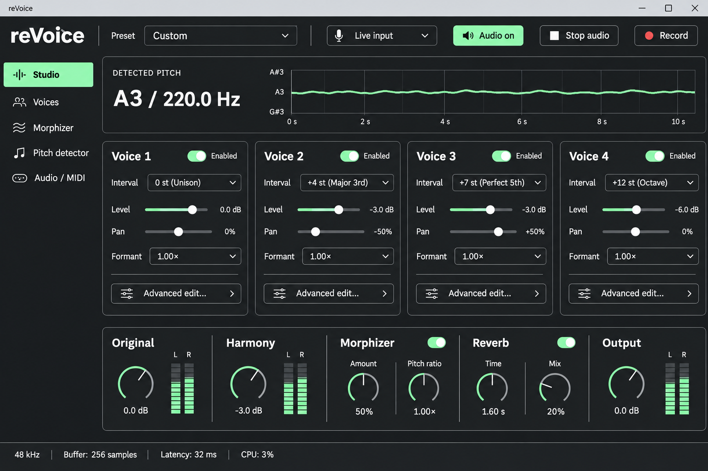
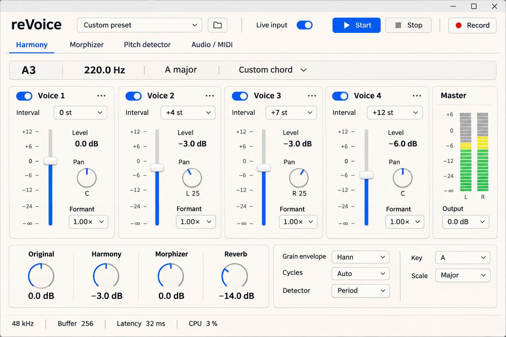
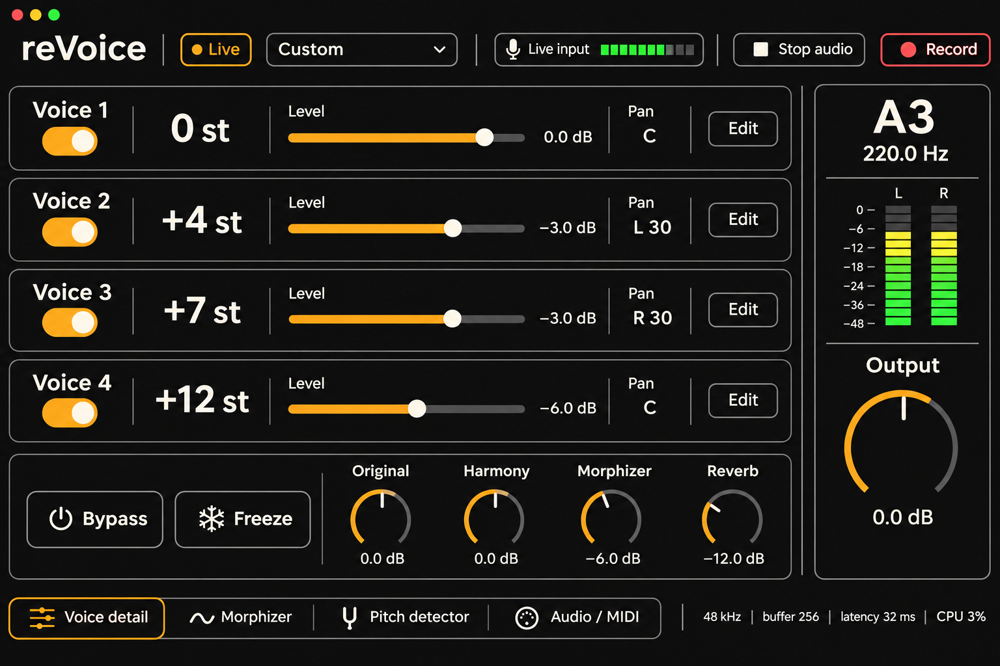

# reVoice UI directions

Three visual concepts for choosing the next interface direction. These are
generated mockups, not screenshots of an implemented application update.
Created using the built-in ImageGen tool. The full generation and refinement
prompt set is saved in [prompts.md](prompts.md).

## 01 — Studio (selected)

Graphite and mint, with four voice cards, a shared mixing strip, pitch display,
and dedicated navigation for advanced settings. Best balance of immediate
control and detailed editing.

## 02 — Clear

A light, neutral mixer with four vertical channel strips and cobalt accents.
Best for users who prefer a bright workspace and familiar fader-based mixing.

## 03 — Live

Large voice rows, bold intervals, amber accents, prominent meters and accessible
bypass/freeze controls. Best for performance and seeing the state at a glance.

The selected Studio direction is implemented as native FLTK widgets in
`app/StudioWidgets.cpp` and `app/MainWindow.cpp`. The implementation uses actual
engine controls and telemetry; the images above remain design references.
